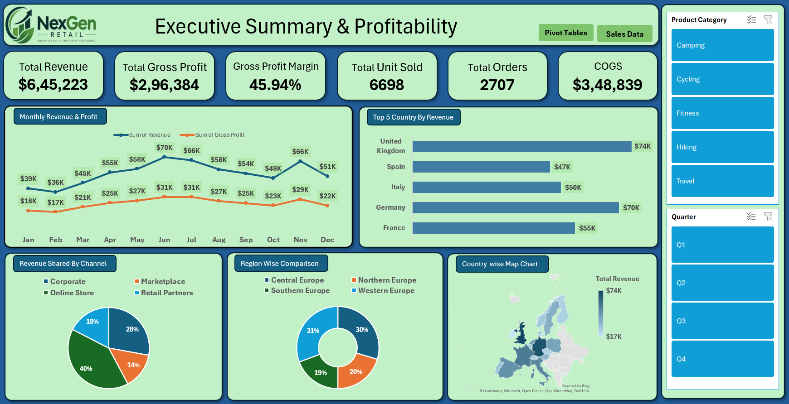

# Executive Summary & Profitability Dashboard — Excel Project

## Project Overview

This project focuses on analyzing retail sales and profitability data using Microsoft Excel. An interactive dashboard was developed to summarize key performance indicators (KPIs), monitor monthly trends, and compare business performance across countries, regions, product categories, and sales channels.

The project uses a fictional company, **NexGen Retail**, to demonstrate practical data analytics and business intelligence skills.

## Project Objectives

- Analyze overall revenue, cost of goods sold, gross profit, and gross profit margin.
- Track monthly revenue and gross profit trends.
- Identify the top-performing countries by revenue.
- Compare revenue contribution across sales channels and regions.
- Build an interactive dashboard using Excel charts, PivotTables, and slicers.
- Present business performance in a clear and understandable format.

## Tools & Skills Used

- **Microsoft Excel**
- Data preparation and validation
- Excel formulas and KPI calculations
- PivotTables and PivotCharts
- Data visualization
- Interactive slicers and filters
- Dashboard design
- Business Intelligence (BI) and descriptive analytics

## Dashboard Preview

## Key Performance Indicators (KPIs)

The dashboard includes the following metrics:

| KPI | Description |
|---|---|
| Total Revenue | Total sales revenue generated |
| Total Gross Profit | Revenue minus cost of goods sold |
| Gross Profit Margin | Gross profit expressed as a percentage of revenue |
| Total Units Sold | Total quantity of products sold |
| Total Orders | Order or transaction count, subject to the dataset's order structure |
| COGS | Cost of Goods Sold |

## Dashboard Features

- **Monthly Revenue & Profit:** Visualizes monthly revenue and gross profit trends.
- **Top 5 Countries by Revenue:** Compares revenue across the leading countries.
- **Revenue Share by Channel:** Shows how revenue is distributed across sales channels.
- **Region-wise Comparison:** Compares performance across regions.
- **Country Map:** Provides a geographical view of revenue.
- **Interactive Filters:** Enables users to explore results by product category and quarter.

## Dataset & Workbook Structure

The Excel workbook contains the following worksheets:

- `Raw_Data` — Original source data.
- `Prep_Data` — Prepared data used for analysis.
- `Pivot_Tables` — Summary tables supporting the dashboard.
- `Dashboard` — Final interactive dashboard.

## Business Value

The dashboard helps users explore sales performance, understand gross profitability, compare business segments, and identify areas that may require further investigation.

It demonstrates how raw data can be transformed into meaningful business information to support data-informed decision-making.

## Project Limitations

- NexGen Retail is a fictional company created for this practice project.
- The reporting period and currency should be interpreted according to the source dataset documentation.
- Gross profit is not net profit because operating expenses and other costs are not included in this analysis.
- Findings should be validated against the workbook before being used for business recommendations.

## Project Files

- **Excel Workbook:** `Executive Summary & Profitability Dashboard- NexGen.xlsx`
- **Project Report:** `NexGen_Retail_Project_Report.docx`
- **Dashboard Screenshot:** `Sales_Dashboard.png`

## Conclusion

This project demonstrates the use of Microsoft Excel for retail data preparation, KPI analysis, business performance comparison, and interactive dashboard development. It is part of my learning journey toward becoming a data analyst.

**Domain:** Business Intelligence (BI)  
**Industry:** Retail  
**Primary Tool:** Microsoft Excel
